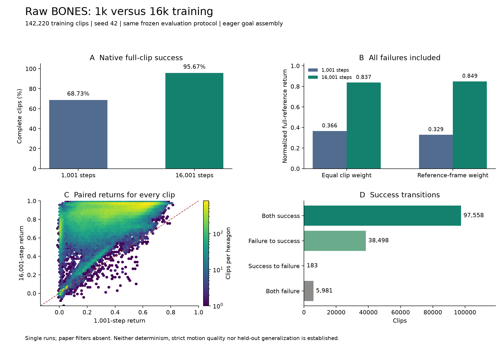

# SuperMimic 官方开源与本地迁移审查

**11月13日初始化协议更正：** 下列旧LAFAN40表格及第9节原始BONES成绩来自本地 `manual-reset-v1` 评估入口。手动设置参考帧后，该入口读取了上一次reset的缓存观测，初始历史也可能受影响；执行器历史还需在最终姿态写入后回填。原始文件、全部失败及计分重算均保留，但这些成绩不能作为“初始观测已验证为参考首帧”的结果。修正后的v2评估必须重跑，见[第18节](#18-手动重置缓存回归与旧评估协议纠正)。三项运行中训练使用原生自动重置，不受此本地离线评估流程影响。

核查日期：2026-11-12，Asia/Shanghai。结论：**论文作者团队已经公开 SuperMimic 实现，值得成为下一阶段的官方对照基线；当前发布包仍有依赖与复现入口缺口，不能直接替换社区实现或接续旧权重。**

截至 2026-11-13 04:49，官方源码与独立 Windows/Linux Conda 环境均已部署，分支 `ljd/official-supermimic` 已推送至现有公开仓库。Windows 与 Linux 各 217 项官方测试通过。原始 compiled 目标拼接在两次 H100 试跑中均于至少 201 次采样后发生 CUDA illegal memory access；同步报错定位于 `_compiled_assemble_goal` 的 Torch/Triton 内核。切换该函数为作者原始 eager 运算后，以下四轮训练和全40评估均完成，最终检查点可读且数值有限。此对照支持编译路径相关的判断，尚未证明具体底层根因。

LAFAN40 使用同一冻结动作集、4096个训练环境、seed 42，评估从每条动作首帧开始，关闭噪声与域随机化，采用作者原生终止条件；所有失败均保留。

| 训练配置 | 采样步数 | 完成整段动作 | 等权动作平均归一化回报 | 训练时间 |
|---|---:|---:|---:|---:|
| 公开默认参数 + eager goal | 1,001 | 0/40 | 0.030332 | 205.42秒 |
| 公开默认参数 + eager goal | 16,001 | 39/40 | 0.843299 | 2129.56秒 |
| 本地论文参数适配 + eager goal | 1,001 | 17/40 | 0.285147 | 593.65秒 |
| 本地论文参数适配 + eager goal | 16,001 | 39/40 | 0.790469 | 2104.16秒 |

归一化分母为完整参考帧数乘每步最大正回报0.1，提前失败后的剩余参考贡献零；并另存按参考帧数加权的汇总。论文汇总权重未获确认。公开默认16k唯一失败为 `fightAndSports1_subject4`，在131.06秒触发 `anchor_pos`。这是训练动作覆盖和原生回报，尚无严格姿态/接触质量或留出集结论。只有一个种子；适配版同时改变优化器、观测历史与调度，不能把提升归因于单项改动，编译缓存也使上述时长不适合直接比较算法效率。

**重复性失败已确认：** `1113c` 对同一个默认16k检查点采用40环境、相同索引顺序的新评估入口，完成了40条动作，但得到38/40，与上述原始39/40不同。一致性检查按预设条件失败，后续24环境分批验证没有执行。随后未修改的旧入口重跑得到40/40，证明当前运行环境下旧入口自身也不重复；这不能反向证明新入口等价。保留全部原始结果与轨迹。因此39/40目前是一次观测，不是已验证的确定性成绩。 新诊断已验证两次数据及检查点哈希一致，40条动作的首帧状态和第一次动作逐位一致；后续状态在1至13帧内出现超过1e-5的分量差异。新增失败是 `fightAndSports1_subject1`（原12257步成功，新1250步失败）。[逐条轨迹诊断](../official-reproduction-20261112/original-vs-batched-trajectories.json) 与 [成绩比较](../official-reproduction-20261112/original-vs-batched-comparison.json) 已保存。`1113d` 已完成，旧入口重复运行的逐条最大归一化回报差为0.380654，最大长度差为5704步。作者依赖的 `mjlab/utils/random.py` 也注明 MuJoCo Warp 尚非完全确定性；具体到哪个内核仍未归因。

收据与逐条结果：[默认1k](../official-reproduction-20261112/lafan40-eager-pilot-summary.json)、[默认16k](../official-reproduction-20261112/lafan40-eager-16k-summary.json)、[适配1k](../official-reproduction-20261112/lafan40-paper-pilot-summary.json)、[适配16k](../official-reproduction-20261112/lafan40-paper-16k-summary.json)。默认16k和适配1k的逐条JSON由各自完整的40行云端日志重建，并与最终计数核对，记录了日志哈希；它们不是云端原始结果文件的逐字节下载副本。

适配16k的训练、配置、评估与协议，以及旧入口重跑的评估、协议和两份比较文件，现已通过短日志片段完整取回，八份文件均与服务器原始字节的SHA256一致，见 [收据清单](../official-reproduction-20261112/cloud-receipts-1113e-ledger.json)。适配16k唯一失败为 `fallAndGetUp1_subject5`，在57.70秒触发 `anchor_pos`；按参考帧数加权回报为0.796026。[旧入口重跑](../official-reproduction-20261112/lafan40-legacy-repeat-summary.json) 得到40/40、等权回报0.852879。重跑与原始运行仅有一条动作的首帧状态出现1.86e-9差异，首次动作全部逐位一致。只有单个训练种子和两次旧入口评估，尚不能可靠估计分布或判断配置优劣。

BONES 原始 G1 数据已完成下载与 SHA256 核验，142,220 条 CSV 全部转换成功，得到 51,915,358 个 50Hz 帧。转换仅适配原始厘米、角度和 Euler 字段，再调用作者的重采样及速度计算代码；未做名称筛选、可行性筛选或地面校准。5 条抽查与作者格式入口逐数组完全一致；内存有界打包在 16 条样本上与作者打包器完全一致。完整 13,575,450,990 字节压缩包已上传个人 AFS，服务器 SHA256 与本地一致；九个数据文件解包时的哈希均通过。解包器对附带校验清单的处理已修复并完成 16 条样本回归验证，云端九个数据文件已全部通过独立 SHA256 读回，最终目录为 `data/bones-packed-raw`，收据见 [bones-cloud-readback.json](../official-reproduction-20261112/bones-cloud-readback.json)。这些是未筛选的原始数据，尚不等于论文筛选后 129,514 条动作实验已复现。

BONES 原始全库的1,001步和16,001步训练及两次完整142,220条评估均已完成。1k完成97,741条（68.73%），16k完成136,056条（95.67%）；平均完整参考归一化回报由0.365661提高到0.837013。配对结果包括38,498条恢复成功、183条退化失败；全部失败均保留。两组共284,440份轨迹已在服务器逐份读验，23成员结果包和六个模型已取回并在本地验证。CPU传输应用已停止、实例为空、端口解绑。完整证据和边界见第9节；这仍是原始训练语料覆盖实验，不是论文筛选数据上的结果。

新增 [分批全库评估入口](../official-reproduction-20261112/evaluate_motion_corpus.py) 复用上述原生评估协议，逐批重置环境及策略历史，并保留每条动作的结果和轨迹。按长度排序只改变批次顺序，不筛掉任何动作；完整结果必须含每个原始索引恰好一次。原始BONES在1024环境下，按原始顺序各批最长长度之和为184,425步，按长度排序为57,293步；这是参考长度计算，不是实际GPU速度实测。`1113c` 的首项一致性检查未通过，详见前述重复性问题；后续 `1113e` 在24环境排序评估的第二批重置处失败：第一批生成的传感器历史缓存属于 inference tensor，旧脚本在退出 `inference_mode` 后尝试原地清零。修复仅把所有批次的重置、观测及步进放入同一个推理上下文，模型构建与载入仍在其外，官方文件不变。使用固定依赖的真实 `ContactSensor.reset()` 在CPU上复现原错误，修复后的连续三次重置通过，见 [针对性验证](../official-reproduction-20261112/batch-inference-reset-validation.json)。修复版 `1113g` 已完成24+16两批全部40条评估，39条成功、1条失败，耗时635.60秒；唯一失败仍为 `fightAndSports1_subject4`，6551步触发 `anchor_pos`，比原始运行早2步。首帧状态最大差为2.38e-7，首次动作40条完全一致；完整成员与非空轨迹文件检查通过。等权归一化回报0.843597，按帧加权0.842745。严格逐条比较仅26/40通过，最大归一化回报差0.003814，因此不宣称轨迹或成绩完全等价。六份原始JSON已完整取回并核对SHA256，见 [收据清单](../official-reproduction-20261112/cloud-receipts-1113g-ledger.json)、[成员与计分核查](../official-reproduction-20261112/lafan40-batch24-accounting.json) 和 [逐条比较](../official-reproduction-20261112/original-vs-batch24-comparison.json)。GPU分批执行与首帧映射已验收；完全一致性未通过；BONES两轮全库执行与产物审计现已完成，见 [验证状态](../official-reproduction-20261112/corpus-evaluator-validation.json)。

以下静态审查与历史对照保留初次审查时的证据边界；当前执行合同见 [experiment-contract.json](../official-reproduction-20261112/experiment-contract.json)，数据验证见 [bones-data-validation.json](../official-reproduction-20261112/bones-data-validation.json)。官方源文件未修改；离线训练包装器替换 W&B 产物上传/清理逻辑，并提供显式 `--goal-backend eager` 对照开关；该开关调用作者相同的目标计算函数，绕过其单独的 Torch 编译包装。公开默认配置保持作者学习参数，论文适配版另改优化器、观测历史与学习率调度，不能用这些实验宣称官方原始性能复现。

## 1. 官方身份与发布日期

- [HybridRobotics/supermimic](https://github.com/HybridRobotics/supermimic) 公开、Apache-2.0，README 链接原论文及项目页，版权声明为 The SuperMimic Authors；Git 历史含论文第一作者 qiayuanl 的实现提交。
- [论文 arXiv:2610.28480](https://arxiv.org/abs/2610.28480) 的题名、作者、项目链接与仓库一致。当前 v2 更新于 2026-11-09。
- GitHub API 的仓库创建时间为 `2026-11-10T10:46:56Z`，北京时间 11 月 10 日 18:46:56；这证明该仓库此时创建，**不据此推定精确转为公开的时刻**。历史提交时间也不能用来推定代码当时已公开。
- 必需依赖 [HybridRobotics/mjlab_research](https://github.com/HybridRobotics/mjlab_research) 现在也能公开获取，本轮 HTTPS fetch 成功。旧 issue 中的依赖不可访问状态不应沿用为当前结论。
- 两个仓库本次 API 查询均没有 GitHub Release。主仓库 README 未给出可直接核验的论文模型下载清单；未测试作者 W&B 模型或数据是否允许匿名访问。

因此，之前“没有完整官方训练实现，只能选择社区版”的判断需要更新；此前研究记录应保留为当时的历史事实。

## 2. 本轮实际 Git 结果

工作仓库：`publication/SuperMimic-Reproduction`；外层 SuperMimic 目录本身不是 Git 仓库。

| 项目 | 固定值 |
|---|---|
| 新分支 | `ljd/official-supermimic`（原名 `codex/official-supermimic-review-20261112`） |
| 起点 | `codex/sports-video-xy-20261110`，`2efb0fcdce28e9920c16986b6456d0bcbeb060ca` |
| 官方主仓库 | `abc124c1bd5976341034668af3d12c087f2f1f55` |
| 官方 mjlab 依赖 | `dd51a9fcc98791a2f0b018b3c7f71a3eefd5ecdd` |
| 引入位置 | `upstream/supermimic/` 与 `upstream/mjlab_research/` |
| 导入量 | 583 个文件，62,938,387 字节；原始 Git 文件模式保留 |

起点工作区干净。检查了 origin 的实时分支：main 为 `9f6a70d`，回放研究分支为 `b190405`，与本地相应跟踪记录一致。两套实现没有共同 Git 祖先，因此通过独立目录导入固定版本，未合并无关历史。官方 Git 历史保留在 `official/main` 与 `official-mjlab/main`。既有实验代码、检查点清单和历史结果不因导入而改变。

## 3. 五个会话与现有实验的关系

本轮通过 `read_thread` 读取五个指定会话的相关回合，并以本地源码和实验文档补充核对。以下训练结果是历史证据，本轮没有重新跑模型或核实云端状态。

| 会话 | 已有积累 | 官方开源后的定位 |
|---|---|---|
| 调研 SuperMimic 社区复现 | Uni-SuperMimic、G1/LAFAN1 旧40；16K 基线；22K/26K/30K；专项与教师约束 | 继续保存社区结果，建立官方实现的独立基线；不同控制器、后端及参考版本不能串成同一训练曲线 |
| SuperMimic 社区复现历史 | 统一55、连续120秒、失败尾部、接触及回退账本 | 评测经验和失败分析可复用，原有分数不能直接当官方分数 |
| 评估 SuperMimic 工程创新 (2) | ARX5 操作、任务专用世界模型、泛化边界 | 当前官方仓库主要是人形动作跟踪；不会自动提供 ARX5/LIBERO 的统一实现 |
| 整理到github | 公开证据仓库、旧经验回放四比例×三种子的课程实验 | 保持已冻结协议；所读最新会话确认12组训练完成并进入统一评测，不能凭该回合断言最终效果已齐备 |
| 评估 SuperMimic 视频复现方案 | GEM-X/SOMA-X 五段视频1956帧；F0/F1 体育续训；旧能力回退诊断 | 前端与数据质量问题独立于控制器，官方代码不能自动修复身份、尺度、地面及接触误差 |

现有 [体育实验记录](../experiments/sports-video/ACTUAL-SPORTS-PILOT.md) 还限定了：F0/F1 都完成单条14.22秒动作；选定旧动作上 F0 在13.36秒失败、F1完成168.2秒。旧40批量诊断有预算截断和数值一致性失败，F1另一个旧动作失败尚未由单环境清除。**这不是全旧40保留，也没有证明 XY 输入总体占优。**

原16K、统一101D分支、专项失败与体育结果都保留各自语义。LIBERO 暂停任务没有因本次导入而恢复。

## 4. 官方代码提供了哪些有价值的对照

| 方面 | 本地社区路线 | 本次官方源码 |
|---|---|---|
| 框架 | UniLab / Uni-SuperMimic | mjlab_research / SuperMimic |
| 状态表达 | 社区世界模型及99D/101D策略接口 | GenCoord 与 MaxCoord 两条表达路线 |
| 观测 | 历史模型为99D，XY扩展101D | 默认 `actor_obs=rep_state`、历史长1；可选 sensor proprio 为93D |
| 策略 | 单目标编码器与共享解码器 | `MultiEncoderAE`，motion/velocity 目标编码器及共享解码器 |
| 世界模型训练 | 短窗口动力学拟合及想象训练 | 多步状态损失、解析积分/FK、物理上下文条件化 |
| 优化 | 既有社区配置 | hidden Linear 使用 Muon，其余 Adam；torch.compile 和 CUDA graph |
| 重置采样 | 固定/混合旧新库及回放实验 | 基于低回报分箱的 `ReturnSampler`，含 explore/focus/keep |
| 数据 | G1 CSV 与社区预处理 | root/joint NPZ 或 packed NPY，显式 joint_names 与 FK 校验 |

数字需按接口分别解释：29关节时，GenCoord 全状态为71D、表示状态68D；sensor proprio 为 `3+3+29+29+29=93D`，另有目标窗口。默认并非“93D＋10帧历史”的部署配置。参考窗口为10帧、间隔5个控制步，约覆盖未来0.9秒。详见 [representations.py](../upstream/supermimic/src/supermimic/representations.py) 和 [runner 默认配置](../upstream/supermimic/src/supermimic/runners/supermimic_runner.py)。

官方仍采用“真实仿真采集 → 拟合动力学 → 世界模型内BPTT优化策略”，与社区版方法主线一致。新结构和实现选择值得实验比较；**源码存在不能证明它在我们55条动作或体育素材上更好。**

## 5. Review 发现：优先解决哪些问题

### P1：两个当前仓库的依赖锁不一致

[supermimic/uv.lock](../upstream/supermimic/uv.lock) 记录 mjlab 1.5.0；[mjlab_research/pyproject.toml](../upstream/mjlab_research/pyproject.toml) 已是1.6.0。用版本约束解析逐项检查，发现8个直接依赖冲突：

| 依赖 | SuperMimic lock | 当前 mjlab 要求 |
|---|---|---|
| Torch | 2.10.0 | >=2.14.0 |
| Warp | 1.14.0 | >=1.15.0 |
| MuJoCo | 3.10.0 | ~=3.16.0 |
| MuJoCo-Warp | 3.10.0.1 | ~=3.16.0 |
| rsl-rl-lib | 5.4.0 | ==5.5.2 |
| viser | 1.0.27 | >=1.1.1 |
| mjviser | 0.0.14 | >=0.0.16 |
| mediapy | 1.2.6 | >=1.2.7 |

影响：旧 lock 无法证明这两个当前提交的组合已验证；允许重新解依赖又会改变环境版本。这里核实的是元数据冲突，尚未执行 `uv sync`，不能虚构具体安装报错。下一步应在独立 Linux/Python3.13 环境确认兼容组合、生成实验专用锁并运行测试，不能复用旧社区环境解释官方结果。

### P1：warm-start 不是完整续训

[runner 的 load_wandb_checkpoint](../upstream/supermimic/src/supermimic/runners/supermimic_runner.py)（第201行）只载入 `world_model.pt`；随后重新构建 actor/critic。第729行起保存世界模型、actor、critic 参数，但没有保存/恢复优化器、回放池、ReturnSampler、迭代数及 RNG 的完整训练状态。

影响：不能用这个参数声称“从原策略接着训练”，也不能作为我们中断恢复与增量学习实验的等价入口。正式续训前需要单独实现并验证恢复合同。旧16K/22K的 state_dict、normalizer 与接口都不同，也没有现成官方转换器。

长跑准备补充（11月13日）：本地训练入口新增可选 `--checkpoint-interval N --keep-checkpoint-series`，保留每个保存时点的三个原生模型及有限值、尺寸和SHA256收据，防止下一次原生保存覆盖历史模型。计数遵循源码零起始迭代，间隔4000对应已完成采样步1、4001、8001等；为保证保存最终步，间隔必须整除 `steps-1`。默认行为仍只保存首尾。已通过 [CPU针对性验证](../official-reproduction-20261112/checkpoint-series-validation.json)，包括源文件覆盖后历史副本不变及非有限模型不能生成完成收据；21步原生GPU集成现已验证1、11、21步的九个模型文件，见 [GPU验证收据](../official-reproduction-20261112/checkpoint-series-gpu-validation.json)；完整长跑尚未完成。这是模型快照保留，仍没有优化器、回放池、采样器、仿真和随机数状态，不能用它宣称完整续训。两组已完成的评估使用原冻结版本，后续长跑的保存扩展单独验证。

### P1（论文复现范围）：默认命令缺少全量实验闭环

[train.py](../upstream/supermimic/src/supermimic/scripts/train.py) 默认引用一条 `lafan_run1_subject5`，支持本地多NPZ及 packed 数据，但没有随仓库提供论文全库固定清单、对应可核验的模型包、完整复现实验配置和结果导出命令。公开的 [benchmark.py](../upstream/supermimic/src/supermimic/scripts/benchmark.py) 测量仿真/世界模型速度，不能替代129,514条动作的逐条成功与回报评测。

SuperMimic 训练入口使用单设备，没有找到自己的 DDP/torchrun 联合训练实现。依赖框架的 PPO 多GPU入口不等于此算法已接通论文双卡流程。4卡可先用于独立实验并行，不能直接宣称官方四卡训练已可运行。

### P2：演示、离线评测与数据转换入口需要分开

[play.py](../upstream/supermimic/src/supermimic/scripts/play.py) 要求 W&B run，读取模型和配置，并显式启用 actor observation corruption；它是交互演示入口。尚未验证各观测路径下的实际噪声效果，不应直接当成固定无噪声评测。

依赖中确实有 [csv_to_npz.py](../upstream/mjlab_research/src/mjlab/scripts/csv_to_npz.py) 和 [pack_motions.py](../upstream/mjlab_research/src/mjlab/scripts/pack_motions.py)。前者按 xyzw 输入、wxyz 输出，支持30→50Hz，并生成 root pose/twist、joint state 和 joint_names；其 CLI 写 `/tmp/motion.npz` 后上传 W&B。后续本地转换可复用 `MotionLoader.arrays()`，另设显式输出路径，避免误把转换命令当成纯本地读写。本轮未调用上传入口。

旧CSV和体育CSV有复用可能，但必须核验关节顺序、四元数、真实帧率、root link与COM、坐标系及地面质量，不能只换扩展名。

### P2：发布CI没有覆盖默认分支

[ci.yml](../upstream/supermimic/.github/workflows/ci.yml) 的 push/PR 过滤为 `master`，而实际默认分支为 `main`；依赖检出仍使用 `MJLAB_PAT`。因此不能据现有配置认定公开 main 的每次提交都经过这些检查。这是源码配置审查，本轮未宣称上游测试通过或失败。

## 6. 对后续研究的判断

**建议采用官方实现作为新的对照底座，先完成一个可比较的小基线。** 官方 native 终止与我们的严格位置/接触门槛分别报告。论文项目页也明确全库动作是训练动作，因此其全覆盖不能被表述为未见动作泛化，更不能自动等价于严格运动质量。

持续学习仍值得研究，但研究问题应从“增加一些工程机制”收敛到：**旧动力学知识的保留和策略对旧状态的覆盖，哪一个决定旧技能是否遗忘？** 官方已有多编码器、速度指令接口及带 keep 项的困难分箱采样，不能再把这些概念本身包装成我们的独有创新。ReturnSampler 的 keep 也不等于显式旧/新任务回放，仍可在固定采集分布下设计世界模型回放 × 策略初始状态回放的2×2对照。

体育路线的关键仍是可靠参考和独立评估。原始视频提取、相机尺度、根轨迹与接触质量不会因为换了控制器而自动改善。官方 actor 目标接口主动去掉 root 相对位置；是否增加场地 XY 反馈是需要单变量验证的设计选择，需明确仿真/真机位置来源。

建议顺序：

1. 固定兼容的官方主仓库/依赖/环境组合，先过单元测试和单动作有限运行。
2. 接入同一旧40数据，建立官方 native + 现有质量指标的双报告；再接入新15，固定分母并保留失败。
3. 取得完整保存/恢复功能后开展旧新技能实验；社区16K保留为历史控制，官方模型独立初始化或用可核验的官方权重。
4. 最后复用经过质量审核的体育动作，并按比赛/选手分割训练与留出集。

上述是后续实验建议，没有在本轮执行。既有课程项目先保持冻结版本，避免在分析中途替换代码、数据或评测合同。

## 7. 本轮验证与边界

- 全部583个导入文件与对应 upstream Git blob 一致；每文件SHA256已记录，Git树与文件模式保留。
- Python3.13.9 对351个官方/依赖Python文件完成语法解析；无源码修改。
- 检查8个直接依赖版本约束冲突；这是已证实的环境元数据问题。
- 原仓库 `check_release.py` 检查633个Python文件、695个JSON、209个报告链接及351个视频；唯一报错是31个既有、被Git忽略的大型训练产物。逐一确认均未被跟踪，未删除或提交它们。该脚本原始退出码为1，不能写成全套检查通过；未报告语法、JSON、链接、历史源码或视频哈希错误。
- [验证脚本](../tools/verify_official_import.py) 无需第三方训练依赖；[完整证据](../validation/official-upstream-review-20261112.json) 记录源版本、API元数据、静态核查和仓库检查结果。
- 初次静态审查时尚未安装运行依赖；后续安装、测试与云端试跑结果见文首的执行状态。本节保留初次导入检查，不代表当前环境仍不可用。

源码同步成功与实验复现成功是两个独立结论。初次审查完成源码同步；后续执行继续沿用这些固定版本，训练与评测结论必须另行验收。

## 8. 论文配置适配与数据筛选补充核查

`run_lafan_pilot.py --training-profile paper-a5-single-gpu` 通过独立的
[paper_profile.py](../official-reproduction-20261112/paper_profile.py) 配置全参数 Adam、
93D 本体感知的10帧历史，以及250,000次采样内衰减至初值0.03倍的余弦学习率。
官方导入文件保持原样；此入口是本地对论文 Tables A.4/A.5 的显式解释，不能称为作者发布的完整配置。
学习率以零起始的仿真采样步计数，在该步之后的模型/策略更新前生效；论文 iteration 与此计数方式的对应尚未获作者确认。
运行长度由命令显式指定，1k试跑不等于论文320k完整训练。

两项CPU数值检查通过：各网络参数仅进入一个Adam优化器，变化学习率下与标准Adam的更新一致；
调度端点及单调性正确，学习率张量地址保持不变。11月13日00:02启动的单卡 `1112f`
又通过三项适配层检查（15.68秒），包括CUDA graph重放使用变化后的学习率。
该任务已完成1,001步训练及完整全40评估，17条成功、23条失败；平台成功、退出码0，三个最终模型可读且数值有限。
该入口尚未解决完整状态恢复、双卡同步、速度编码器配置或全库筛选缺失。

按当前 SONIC 官方筛选脚本的固定版本
[`1e1ec4f`](https://github.com/NVlabs/GR00T-WholeBodyControl/blob/1e1ec4f5f27e6c3e03048f693bd7c60cce04afda/gear_sonic/data_process/filter_and_copy_bones_data.py)
对142,220个原始动作名做只读匹配，排除12,435条、剩余129,785条，与论文名称筛选后的129,667条不一致。
当前SONIC规则还含 `handstand`、`cartwheel` 等关键词，不能未经成员核对就复制成SuperMimic筛选器。
论文只说明沿用SONIC并补充少数词，没有给出确切版本和完整关键词；后续可行性筛选也有未量化门槛。
因此暂不通过凑齐条数来建立“论文同一数据集”。详细计数与源文件哈希见
[只读筛选核查](../official-reproduction-20261112/sonic-name-filter-audit.json)，原始数据未改变。

另有未在适配层改动的差异：论文D.1把10%的keep项描述为历史softmax权重，
而固定源码 [reset_sampling.py](../upstream/supermimic/src/supermimic/runners/reset_sampling.py)
的 `_distribution()` 累加 `focus.double().square()` 后归一化。
这会更偏重曾经高度集中的困难分箱；它不是直接累计权重的同一个公式。
目前保留作者发布的实现并明确记录，不能声称此适配层已经逐项还原论文。

## 9. 原始 BONES 完整训练对比与产物验收（11月13日04:29）

两次训练均从seed42独立初始化，使用同一原始142,220条动作、51,915,358帧、4096训练环境、单卡论文参数适配和eager目标拼接。完整配置逐项比较，除进程内函数地址表示外，差异只有采样步数、`max_iterations`及首尾保存间隔；见 [配置比较](../official-reproduction-20261112/bones-raw-training-config-comparison.json)。这不证明两次运行的随机状态序列或仿真轨迹逐位相同。

| 项目 | 1,001步（1113a / 1113h） | 16,001步（1113f / 1113i） |
|---|---:|---:|
| 训练计时 | 358.59秒 | 2171.62秒 |
| 完整评估计时 | 3483.60秒 | 3590.54秒 |
| 完成整段动作 | 97,741 / 142,220（68.73%） | 136,056 / 142,220（95.67%） |
| 失败动作 | 44,479 | 6,164 |
| 等权动作平均归一化回报 | 0.365661 | 0.837013 |
| 按参考帧数加权归一化回报 | 0.329206 | 0.848584 |
| 已跟踪帧数 / 全部参考帧数 | 76.82% | 97.79% |

该图由完整142,220行配对CSV生成，可用 [绘图脚本](../official-reproduction-20261112/plot_bones_pair.py) 从本地验证包重建。

评估协议为首帧开始、1024环境、固定按长度排序、无观测噪声和域随机化、原生终止条件。两次完整协议和九个打包数据哈希一致；配对工具要求每个索引恰好出现一次，失败尾部按零计分。**这里的“完整”指所有成员都被评估，并不表示所有动作都成功。**

逐动作比较：97,558条两次均成功，38,498条从失败变成功，183条从成功变失败，5,981条两次均失败。141,371条归一化回报提高、849条下降；等权回报平均差为+0.471352，成功率提高26.94个百分点。这是两个冻结模型的描述性对比，只有一个训练种子和每模型一次全库评估；183条退化不能单独归因为遗忘，既有重复性问题仍存在。 进一步按全部配对CSV分析，183条退化中116条的归一化回报仍上升，37条在参考前半段失败，仅5条跟踪达到95%以上；另有102条两次均成功但回报下降。因此完成率和奖励均值需要同时保留，不能把退化全部解释为临近结尾的小数值误差。见 [退化聚合诊断](../official-reproduction-20261112/bones-raw-regression-diagnostics.json)。

[完整配对汇总](../official-reproduction-20261112/bones-raw-pair-summary.json)、[1k计分](../official-reproduction-20261112/bones-raw-1k-accounting.json)、[16k计分](../official-reproduction-20261112/bones-raw-16k-accounting.json) 均为服务器原文件字节。本地又用Python `math.fsum`逐条独立重算两个平均回报、加权回报和所有成功转移，与服务器结果在1e-12容差内一致，见 [独立重算](../official-reproduction-20261112/bones-raw-pair-independent-recomputation.json)。

零GPU后处理 `1113k`（UID `fd038affc0ff4ee0aa7d7b06a83977b9`）读取了全部284,440份成功和失败轨迹，共34,427,034,143字节。NPZ压缩校验、float32类型、有限值、71D状态/29D动作宽度、步数与float64奖励和均通过；奖励和最大差为0。两次审计耗时556.66秒和619.54秒，每个文件的SHA256均保存在完整清单。见 [1k轨迹审计](../official-reproduction-20261112/bones-raw-1k-trajectory-integrity.json) 和 [16k轨迹审计](../official-reproduction-20261112/bones-raw-16k-trajectory-integrity.json)。旧计分收据中的数组审计字段保留生成当时的false值，此后完成的数组检查由这两份独立收据证明。

23成员证据包为185,928,623字节，SHA256 `77c49a6efce70dc90e4cbf836ff67369038553c2599b293eaa01e16f4d0cf692`。已核对下载整体、每个成员及原始训练模型的哈希；六个模型在本地CPU以`weights_only=True`载入且所有浮点张量有限。见 [取回清单](../official-reproduction-20261112/bones-raw-pair-receipt-ledger.json)、[包成员清单](../official-reproduction-20261112/bones-raw-pair-package-manifest.json) 和 [本地模型验收](../official-reproduction-20261112/bones-raw-pair-local-verification.json)。大型逐条JSON、CSV和模型保存在本地验证包，原始轨迹留在AFS，没有写入Git历史；本地包不包含全部轨迹数组。

首次CPU后处理 `1113j` 因实际提交命令与本地脚本不一致而立即失败，没有开始数组检查。修正使用单行压缩脚本入口，提交前从编辑器渲染全文逐字核对，服务器解压后验证脚本SHA256；`1113k`最终退出码0。取回用CCI期间再次发生原因不明的提前停止，恢复后成功完成传输，随后主动停止应用并确认无实例、DNAT解绑。两次GPU评估和CPU后处理均为平台成功状态。后续长跑另见第11节。

**目前可得结论：** 在这套固定的原始训练语料、适配配置和一次评估中，增加训练步数带来明显覆盖与原生回报提升，同时存在局部退化。尚未完成论文320k训练、精确129,514成员筛选、双卡同步、速度接口实验或严格姿态/接触质量评测；仿真确定性及未见动作泛化也未验证。不能把95.67%换算成论文的“3小时仅25条失败”，也不能把文件完整性解释为运动质量合格。

## 10. 速度接口与论文 Appendix G 的进一步核对

11月13日重新检查官方公开记录，[Release 页面](https://github.com/HybridRobotics/supermimic/releases) 仍无发布包。[Issue #2](https://github.com/HybridRobotics/supermimic/issues/2) 和草稿 [PR #3](https://github.com/HybridRobotics/supermimic/pull/3) 讨论的是只启用速度接口时被移除的 motion anchor。固定源码的实际类也会触发该断言，但论文 Appendix G 的两种训练都使用50/50的动作与速度接口，因此这条初始化错误本身不阻断论文规定的混合配置；不能把合入这个草稿当成完成速度实验。

更关键的是，固定的官方提交 `abc124c` 与论文速度实验之间还缺少以下对应关系。结论针对本次导入的版本，没有推断作者私有训练代码的行为。

| 项目 | 论文 Appendix B、Table A.4、Appendix G | 当前导入源码 |
|---|---|---|
| RL速度目标 | 速度跟踪奖励、仅跌倒终止；参考命令和随机保持命令混合 | `MultiTaskWorldModelEnv` 所有接口仍走动作跟踪奖励与终止；速度命令由参考速度加逐步噪声得到 |
| 命令坐标系 | 平面速度在仅含yaw的heading坐标系，角速度取世界yaw分量 | `make_velocity_task` 使用完整根姿态的逆旋转，得到body坐标分量 |
| 速度编码器 | 3D命令加10帧观测的特征，独立的两层256结构 | 编码器只接收3D命令，历史只送入共享解码器，编码器共用传入的网络宽度配置 |
| 下游梯度 | 速度目标的回报梯度通过解码器传向编码器，但不更新解码器权重 | actor的普通forward和策略优化路径没有按接口冻结解码器权重；潜变量BC的stop-gradient不是这项冻结 |
| critic与起始状态 | 每个接口自己的critic；从各自仿真环境的状态开始想象 | 当前runner构建单个critic，想象起始状态从共同回放池抽取 |

已用实际导入的类做隔离CPU探针，见 [数值与源文件哈希](../official-reproduction-20261112/velocity-paper-contract-audit.json)：根pitch为45°、世界前向/转向速度均为1时，当前命令为 `(0.7071, 0, 0.7071)`，heading约定为 `(1, 0, 1)`；只经过速度槽的actor损失仍能对解码器产生非零梯度。另一个两片段探针确认，当前中心窗口可跨拼接边界，把后一段速度混入前一段；论文没有说明这一边界细节，需单独确定处理合同。探针没有运行GPU训练，也没有擅自合入社区补丁。

因此，后续100,000步速度实验需要明确实现并验证上述训练路径，以及672个命令、每命令4次、5秒响应和最后2秒误差的评测；只把 `slot_mix` 改成50/50会得到当前公开实现的混合动作目标，不能标作论文的RL速度编码器。已完成的两组纯动作跟踪BONES评估使用原冻结版本。

## 11. 有时限的原始 BONES 长跑（11月13日04:49）

完整1k/16k对比与产物验收后，已提交 `1113m`（UID `283c2489542e47a68ca2493c1ad2d835`），单张H100、4vCPU、64GiB、零自动重启。程序于04:44:17启动，外层最多17小时，截止21:44:17，终止信号后另给30秒；训练阶段单独限制14小时，最终全库评估限制6900秒。完整固定条件见 [运行计划](../official-reproduction-20261112/bones-raw-320k-run-plan.json)。

脚本先运行21步LAFAN40的GPU集成检查，要求在已完成采样步1、11、21保留三个完整模型组并逐文件重算哈希。只有该检查通过才从seed42重新初始化原始BONES训练。目标320,001次采样，对应源码零起始步号0至320000，保存间隔4000，保留81组模型。该额外一步用于覆盖最后的原生保存时点；它不是对论文iteration语义的确认。所有快照仍仅含模型和注册缓冲区，没有完整续训状态。训练成功后用相同冻结评估器评估全部142,220条，保留全部失败和轨迹。

当前已验证启动脚本、三个内嵌Git源码文件及两个冻结评估器的SHA256。21步GPU保存检查已通过：1、11、21步的九个模型文件均经有限值检查，并独立重算保存副本哈希；原始结果JSON已完整取回并核对SHA256，见 [GPU保存验证](../official-reproduction-20261112/checkpoint-series-gpu-validation.json)。04:48:12已进入原始BONES长训练阶段并加载完整142,220条/51,915,358帧；训练阶段最晚18:48:12结束，整体最晚21:44:17结束。已观察到8,461次主训练采样，日志中损失与奖励为有限值。05:00:09的第4,001步保存完成标记及三个文件哈希均已从离线日志核对，见 [中间模型观察](../official-reproduction-20261112/bones-raw-320k-checkpoint4k-observation.json)；原始manifest字节和模型文件尚未取回。长训练与最终评估仍未完成。前一次 `1113l` 在训练前下载GitHub脚本连续超时并结束；`1113m`改为随入口携带同一固定提交的源码，消除启动外网下载依赖，没有改变学习参数或官方导入文件。不能从“运行中”推断320k结果已完成，精确论文筛选、多卡、速度任务、确定性与运动质量缺口仍然存在。

## 12. 速度任务组件实现与CPU验收（11月13日05:05）

已增加独立的 [速度任务合同](../official-reproduction-20261112/paper_velocity_contract.py) 与 [速度actor/critic组件](../official-reproduction-20261112/paper_velocity_actor.py)，使用本地官方Conda环境中的真实导入模块。表A.6原页渲染确认：线速度指数分母为0.5²，yaw指数分母为0.5；每步正奖励上限为4×0.02=0.08。奖励函数包含动作差、线性关节越界、躯干侧倾和roll/pitch角速度惩罚；躯干几何量由后续仿真适配层传入，当前没有假称已完成该几何接入。

命令模块使用yaw-only平面速度和世界yaw角速度。RL命令源在reset及每250步重采样，默认50%参考、50%均匀保持命令，后者10%为站立；参考命令保持更新且不裁剪到随机命令范围。参考速度先逐帧投影到参考heading，再做25帧中心平均；窗口在片段边界重复端点。这两个计算顺序/边界选择已显式记录，尚无作者确认。

速度编码器使用3D命令和展平的归一化观测历史，隐藏层256×256；历史feature的具体提取器未在论文中定义，因此该选择不能标作作者原始实现。下游回报通过解码器输入传向编码器，但解码器全部参数（含LayerNorm）使用detach后的参数视图；运动接口仍通过普通解码器更新其权重。0.1的潜变量对齐仅应用于参考命令，motion latent及BC输入停止梯度。独立的motion/velocity critic按显式接口位路由，速度critic只接收自己的3D命令；时间展平和小批次打乱不会改变其接口身份。

Step-test工具生成每平面224个非站立点、合计672个平面/格点身份；三个平面坐标轴相交，因此只有630个独立物理命令，保留重复位置才能符合逐平面计数。汇总使用四次5秒试验，在非跌倒试验中计算最后2秒的平均误差向量的模，再除以命令模，并取标准中位数；0.9仅用于显示。四次均跌倒保留raw error为null和all-fall标记，绘图显示0.9，避免把显示上限当成实测误差。

[10项针对性CPU检查](../official-reproduction-20261112/paper-velocity-components-validation.json) 已通过，包括俯仰不改变heading命令、片段边界不混入相邻动作、命令保持与局部reset、两种奖励分母、临界跌倒条件、672格点计数、偶数试验的中位数、下游解码器权重梯度为零而编码器/输入梯度非零、参考BC梯度隔离、critic打乱不变性。测试使用小网络验证计算与梯度路径，没有启动速度GPU训练。

**仍需完成完整速度runner：** 4096仿真环境和想象批次的50/50接口分配、仿真中的速度奖励/跌倒和躯干几何、命令源/保持年龄的回放记录、从各接口自己的环境状态采样想象起点、训练参数与模型保存/载入，以及真实物理的672×4次step test。行走/跑步库的精确论文成员也未给出。当前组件测试不证明100k训练或速度实验结果已复现；运行中的1113m继续使用已冻结的纯运动训练版本。

## 13. 速度训练入口接通与真实GPU集成准备（11月13日05:27）

已新增 [混合接口运行时](../official-reproduction-20261112/paper_velocity_runtime.py)、[训练runner](../official-reproduction-20261112/paper_velocity_runner.py) 和 [有限训练入口](../official-reproduction-20261112/run_velocity_training.py)。RL模式的后半环境使用表A.6速度奖励和跌倒失效条件，前半保留运动跟踪；蒸馏模式的两半都保留运动奖励和终止。参考片段结束及原有时间上限仍作为truncation保留，不计作速度跌倒。真实仿真与想象环境共用奖励核，奖励管理器只乘一次dt。

回放增加命令、保持命令、参考来源、当前保持年龄及接口身份。各接口想象起点通过原生ReplayBuffer的独立环境视图采样，游标和填充量实时跟随主环形回放，并检查记录的来源身份；10帧因果历史也来自同一接口。想象状态从记录的命令源和年龄继续，在250控制步边界重采样。实际采集与想象都按50/50路由，critic携带的显式接口位能在随机小批次后继续选择正确网络。

两个仍需作者确认的实现选择也显式记录：躯干侧倾sine取其unit Z轴在root-heading frame中的Y分量；想象跌倒对归一化高度/倾斜边界使用原生softness平滑。原生return sampler仅用运动半区的奖励计算参考重置权重，并给两半共享这些权重，避免用随机速度奖励评价运动片段。critic保留原生优化器和共同有效回报上界，两套价值网络本身独立。

完整速度实验入口要求明确的行走/跑步库成员和打包哈希清单，固定100,000次采样；原生间隔4000的保存落点是1、4001…96001，因此循环结束后额外按原生格式保存第100000步的实时模型，并保留旧副本。短GPU集成使用明确标记的LAFAN40控制库，21步、4096环境，每10步保存；这些短跑不能作速度论文成绩。

[8项新增CPU接线检查](../official-reproduction-20261112/paper-velocity-runtime-validation.json) 已通过，使用真实原生奖励/终止管理器、ReplayBuffer及确定性场景/FK/动力学张量夹具，验证dt缩放、两种模式终止、接口回放、10帧历史、命令年龄和最终尾步保存。它们没有执行真实G1物理或CUDA图。下一项GPU验收预设为两种模式各21步，必须观察两个learner实际更新并完成原生CUDA graph capture、每次更新指标有限、真实采集字段有限、回放来源身份正确、RL两种命令源都出现、三个时点模型完整且有限；再验收原始结果与配置收据。当前没有报告这项GPU集成通过，也没有启动100k速度训练。

## 14. 速度GPU实跑与候选动作库（11月13日05:52）

固定提交 `569660d` 的单卡集成任务 `1113n` 已完成RL模式的21次真实G1采样：世界模型和策略各更新6次，两者均完成原生CUDA graph capture；全部更新指标及7类回放数值字段有限。运动/速度接口各占2048个环境和想象起点，来源身份核对通过，速度半区的参考命令占48.63%，命令年龄均在0至249。第1、11、21步完整保存三模型并检查有限值及SHA256，最终原生文件与保存副本一致。训练循环计时652.13秒，包括首次混合路径编译，不能当作稳定训练吞吐量。

该作业随后进入蒸馏模式；目前两模式的原始JSON收据尚待完整取回，不能把单模式通过写成整项验收完成。短跑仍使用LAFAN40控制库；没有100k速度成绩或step-test结果。原始BONES长训练 `1113m` 已观察到27,241次采样，损失与奖励有限，仍在运行。

新增 [候选库构建器](../official-reproduction-20261112/prepare_velocity_library.py) 以固定、不区分大小写的动作名规则选取 `walk/walking/run/running/jog/jogging` 单词前缀，保留所有命中片段的完整帧。没有使用训练回报、成功率或人工挑选来筛选。BONES中41,812条、LAFAN40中16条，共41,828条、15,469,495帧、85.9416小时；加来源前缀避免名称冲突。六类float32数组的每个选中片段在落盘后重新打开并与原始数据逐字节比较，9个packed文件的总大小4,395,656,835字节，完整成员CSV及各文件哈希见本地记录；公开的 [验证清单](../official-reproduction-20261112/velocity-library-name-v1-validation.json) 仅含规则、计数和哈希，不包含动作坐标。

清单的 `verified_walking_running_library` 仅表示名称规则及所选字节已经验证。作者精确成员、语义标签和物理质量均未确认，因此它是本地名称候选集，不能称作论文相同的walking/running库。当前打包与字节比较已在本地完成，服务器版本尚未建立。

## 15. 双模式GPU验收完成与数据哈希差异（11月13日06:06）

`1113n` 已于05:54:59完成，平台成功、退出码0。RL和蒸馏各21次采样、两个learner各6次更新，均捕获原生CUDA图；两模式的完整三模型保存点都是1、11、21，更新指标、回放字段和接口来源检查全部通过。RL参考命令占48.63%，蒸馏为100%。训练循环含首次编译分别计时652.13秒和445.17秒，不据此声称稳定速度或控制质量。两份原始结果及两份完整配置JSON均从离线日志恢复，字节数和SHA256完全匹配；见 [GPU验收](../official-reproduction-20261112/velocity-integration-gpu-validation.json)、[四份原始收据清单](../official-reproduction-20261112/velocity-integration-1113n-receipt-ledger.json)、[RL结果](../official-reproduction-20261112/velocity-rl-integration-1113n-result.json) 与 [蒸馏结果](../official-reproduction-20261112/velocity-distill-integration-1113n-result.json)。模型在服务器检查有限值与副本哈希，尚未把这些短跑模型下载到本机。

零GPU候选库作业 `1113o` 于05:57:33开始，05:58:41退出1：六类数值数组都通过服务器落盘后的源片段字节比较，最后跨机器比较却报 `AssertionError: packed_files`。这是验收失败，不能写成云端候选库字节一致；原目录完整保留。新增 [只读差异审计器](../official-reproduction-20261112/audit_velocity_library.py)，分别记录完整文件、NPY头部和数组payload哈希，先写完整审计再判断，定位差异期间不改动两端数据。在完整本地候选库上的实际只读运行通过；服务器差异诊断待执行。

06:13:57的只读诊断 `1113p` 已导出 [完整审计](../official-reproduction-20261112/velocity-library-audit-1113p-result.json) 及 [原始云端清单](../official-reproduction-20261112/velocity-library-cloud-1113o-manifest.json)，两份收据的原始字节和哈希均匹配。仅 `root_ang_vel_w.npy` 与 `root_quat_w.npy` 的数组payload不同，其余7个packed文件和成员CSV一致。**后续本地全量来源核查纠正了第14节的父库假设：** 本地BONES全部9文件符合冻结协议，本地LAFAN40只有7文件符合，另外2文件正是上述数组；服务器速度训练原始配置中的LAFAN40全部9个实际哈希均符合冻结协议。旧本地候选清单中的父文件哈希来自历史协议，不能证明构建时这2个本地数值文件相同；原清单和数据保留为历史版本。差异形成的具体原因尚未查明，不能归因于文件头或数值平台差异。见 [父库纠正记录](../official-reproduction-20261112/velocity-library-local-parent-correction.json)。

构建器现已在选择片段和创建输出前，重新核对两个父库全部18个文件。修正后的入口在本地实际运行，正确拒绝有差异的LAFAN40且未创建输出目录；不继续沿用“过去核验过所以现在相同”的假设。下一次服务器构建使用新目录，必须先通过全部18个父文件哈希，再逐片段比较数组并核对与既有云端候选的9个输出文件哈希。两个CPU作业的失败和原目录均保留，不把诊断已完成写成数据一致性通过。

## 16. 严格父库候选验收与两组100k训练启动（11月13日06:43）

零GPU新构建 `1113q` 于06:20:17开始，06:22:33成功退出0。两个父库全部18个文件在选择前重新哈希并匹配冻结协议，六类数值数组的所有选中帧均与父片段逐字节比较，9个候选文件及完整成员CSV与保留的云端版本一致。实际构建134.15秒；41,828条、15,469,495帧、85.9416小时、4,395,656,835字节。两份原始JSON已完整恢复并复核SHA256，见 [严格父库构建清单](../official-reproduction-20261112/velocity-library-cloud-1113q-manifest.json)、[最终验收](../official-reproduction-20261112/velocity-library-cloud-1113q-validation.json) 和 [原始收据清单](../official-reproduction-20261112/velocity-library-1113q-receipt-ledger.json)。旧本地候选及两个失败作业均保留；本地LAFAN两数组仍待单独恢复，不能声称本地和服务器父库已经统一。

两个100k速度作业已各自从头启动，使用相同的严格父库候选、seed42、4096环境、50/50运动与速度接口及单卡论文参数适配。每个任务一张H100、4核/64GiB、单副本、零重启；训练上限7小时，整体上限7.5小时。原生1、4001…96001保存点和循环结束后的第100000步模型共26组三模型，模型有限值和副本哈希验证继续启用；它们不是包含优化器、回放及RNG的完整可恢复检查点。

| 作业 | 程序开始 | 整体退出期限 | 当前直接证据 |
|---|---|---|---|
| [RL100k / 1113r](../official-reproduction-20261112/velocity-rl-100k-run-plan.json) | 06:30:18 | 14:00:18 | 8份源码哈希匹配；已观察191次真实混合采样 |
| [蒸馏100k / 1113s](../official-reproduction-20261112/velocity-distill-100k-run-plan.json) | 06:35:41 | 14:05:41 | 数据入口及8份源码哈希匹配；已加载完整候选库，训练循环待进一步观察 |
| [原始BONES320k / 1113m](../official-reproduction-20261112/bones-raw-320k-run-plan.json) | 04:44:17 | 21:44:17 | 已观察51,941次采样，最新损失与奖励有限 |

同时使用的三张卡属于三个独立作业，不构成论文双卡同步训练的证据。100k训练、672×4次step test和其最终结果均未完成；候选成员及适配层中需要作者确认的选择仍然存在，不报告为严格论文速度实验复现。

## 17. 站立起步step-test入口与预设GPU验收

新增 [step-test入口](../official-reproduction-20261112/evaluate_velocity_step.py)，每个已完成模型覆盖672个格点身份、每命令4次试验，共2688次，保持50Hz固定命令5秒，以最后2秒速度平均误差向量的模除以命令模。完整文件和数组的哈希绑定实际训练模型及数据；只有100000步完成模型可走experiment入口，短模型仅允许integration。评估只启用速度接口，以真实物理的刷新后root状态判定首次跌倒；运动片段、计时和跌倒manager均不会在响应期间重置状态。

初始状态采用固定机器人源码中的默认屈膝姿态、零速度，四次显式reset种子42至45，无物理随机化。每次完整71D初始状态都必须匹配声明姿态；这四次试验具有名义相同的初始条件，不声称独立随机扰动或GPU确定性。论文没有给出确切站立关节姿态及四次试验扰动，此处属于明确的本地协议选择。保存初始及post-step状态、pre-step动作、post-step heading速度，首次跌倒后终止该试验记录，用steps标识有效长度并将无效尾部填NaN；非跌倒试验必须完整250步。保存的NPZ会重新打开核对有效值、填充区和失败计数；all-fall保留raw error为null，0.9只用于显示。

源码及API核对和Python语法检查已完成，[GPU验收条件](../official-reproduction-20261112/velocity-step-evaluator-plan.json) 已在执行前固定：使用两份已完成21步模型分别运行完整672×4试验，检查声明姿态、无中途manager重置、存活试验完整长度、全部失败和轨迹数组读回，并恢复原始结果与协议收据。尚未报告此项真实物理集成通过，短模型结果不用于论文速度成绩。

## 18. 手动重置缓存回归与旧评估协议纠正

`1113t` 于06:56:04开始，06:58:31被“观测到的完整71D初始状态必须匹配声明站立姿态”的检查拒绝，06:58:36退出1，尚无完成的物理试验。两份模型结果收据和五份源码哈希在失败前均核对通过；该失败保留，不放宽姿态检查。问题位于本地新增的手动重置流程：原生 `ObservationManager.compute(update_history=False)` 会返回缓存；写qpos/qvel后执行forward和sense，不会清空此观测缓存。

新增 [手动重置刷新函数](../official-reproduction-20261112/manual_reset_observations.py)，按原生reset流程在最终姿态后对所有环境回填执行器历史，再forward/sense、重置观测缓存并显式 `compute(update_history=True)`。重新计算的full_state必须与当前物理状态一致，随后仍须通过原有默认站立姿态检查。使用真实原生ObservationManager和确定性张量/执行器夹具的 [回归检查](../official-reproduction-20261112/manual-reset-observations-validation.json) 已复现旧缓存返回并通过修复，1项、3.73秒；它不替代修正后真实G1验收。

源码追查发现，本地旧 [LAFAN评估](../official-reproduction-20261112/evaluate_lafan40.py) 和 [完整动作评估v1](../official-reproduction-20261112/evaluate_motion_corpus.py) 同样在 `reset_to_frame` 后直接使用缓存读取。初始state/action上下文因此来自此前env.reset的观测；这些评估设置 `sampling_mode=start`，原生reset会使用全库第0帧，而后续手动重置才移至各自参考片段。10帧历史配置还会把该初始观测保留至后续历史替换完毕。这不否定原始文件校验和已记录分数的算术一致性，也不影响原生自动reset训练，但要求纠正首帧协议的科学资格并重新评估。具体分数变化尚未量化，不能假定修正一定提高成绩，也不能把旧的183条退化全部归因于此。

旧入口和所有原始收据保持不变，新增 [完整动作评估v2](../official-reproduction-20261112/evaluate_motion_corpus_v2.py) 使用上述刷新函数并在协议/结果标明版本2。完整纠正范围及后续工作见 [初始化协议纠正记录](../official-reproduction-20261112/evaluation-initialization-correction.json)：先通过修正后的G1站立验收，再对同一冻结1k/16k模型各重跑全部142,220条；320k作业继续执行其冻结版本，旧最终评估将保留并另做v2评估。当前三项训练计划不变，速度RL已观察8,551步、蒸馏6,631步，指标有限；两个100k结果仍未完成。官方HEAD另于11月13日重新查询，仍为固定的 `abc124c1`。

## 19. 修正后站立评估真实GPU验收完成（11月13日07:18）

新作业 `1113u` 使用固定提交 `b76a781`，07:15:01开始、07:18:49成功退出0。两模型各672个命令、每命令4次试验，共5,376次；全部完整71D初始状态符合声明站立姿态及实际物理状态，四次批量重置/模型均刷新缓存并回填执行器历史。刷新前后full_state的最大分量差为4.44807，八次均非零；这是混合量纲状态分量差，不解释为位置误差。修正后保持原严格姿态门槛通过，支持先前失败由缓存观测引起的判断。见 [GPU流程验收](../official-reproduction-20261112/velocity-step-gpu-validation.json)。

这两份模型仅训练21步，**每模型2,688次试验全部跌倒，672个命令全部all-fall**。原始中位误差为null，0.9仅作为图示上限；没有把失败记成有限误差平局，也没有报告已学会速度控制。完整保存首次跌倒前轨迹，服务器重新读取NPZ验证有效值与无效NaN填充、从保存状态复算首次跌倒和float64 heading速度、从保存速度复算全部命令得分。两份轨迹文件合计39,111,064字节，尚未下载本机。

四份结果/协议原文件已完整恢复并核对字节数和SHA256，见 [收据清单](../official-reproduction-20261112/velocity-step-1113u-receipt-ledger.json)。[独立比较工具](../official-reproduction-20261112/compare_velocity_step_results.py) 又使用Python statistics核对全部672条计数及中位数；[比较记录](../official-reproduction-20261112/velocity-step-1113u-comparison.json) 保留672个双方all-fall，有限误差平局为0。该流程验收与21步模型的控制能力是不同结论；100k模型仍在训练，完成后使用同一修正协议评估。下一项有限实验是修正后的v2动作评估，先验证固定LAFAN40模型，再对原1k/16k冻结模型各重评全部142,220条，并保留所有旧版成绩及失败。

## 20. 修正后完整动作重评已启动，40条检查完成

新任务 `1113v`（UID `e0b55c6ef22048c289928b39f23e8d33`）于11月13日07:39:01实际启动，单张H100、4核、64GiB、零重启，整个程序最迟11:39:31强制退出。提交前逐字核对21,701字符启动命令；启动后核对五份冻结源码、三组模型元数据与哈希、两份站立验收结果收据。使用 `7ab27b8` 中的v2评估入口，未修改三个在训任务。详见 [启动与阶段记录](../official-reproduction-20261112/manual-reset-v2-launch.json)。

固定LAFAN40、16,001步模型已完成全部40条、441,140个参考帧的评估，39条成功、1条失败，平均归一化回报0.7971319807437383，实际跟踪437,596帧，比例0.9919662692115881。失败 `run1_subject5` 的原生终止项是 `anchor_pos`。全部40条初始完整71D观测与目标参考帧匹配，最大分量差4.76837e-7。服务器完整索引/文件/计数检查通过，本机从40条日志记录独立复算均值一致；目前 [40条中间记录](../official-reproduction-20261112/manual-reset-v2-lafan40-interim.json) 是日志重建，尚未声称已恢复原始result/protocol文件或逐个读取NPZ。旧v1成绩与本次结果不能作缓存修复的因果对照，GPU重复性尚未确认。

07:47:03开始同一冻结1,001步模型的全142,220条BONES重评；首批1,024条初始观测验证通过，最大分量差9.52510e-7。随后将使用同协议评估同一16,001步模型并完整配对成功与失败，任务未完成前不报告新版全库分数。后续 [保存首帧独立核查](../official-reproduction-20261112/audit_saved_initial_states_v2.py) 将在读取所有NPZ及校验奖励合计的同时，使用NumPy从九份哈希固定的源数据重建参考首帧，核对关节顺序、原生限位裁剪以及实际保存的71D第一行。[四项CPU回归](../official-reproduction-20261112/saved-initial-states-v2-validation.json) 已验证正常和失败片段均覆盖，且可拒绝替换为前一动作缓存、未裁剪关节和源数据变更；真实全库轨迹审核仍待评估完成后执行。

本轮观察到BONES长训练81,411次采样更新、速度RL30,021次、蒸馏28,871次，相关训练损失/奖励为有限数值。三项均未完成，训练奖励不作为冻结模型评测成绩；仍未宣称论文结果已复现。

## 21. 相同39/40计数掩盖不同失败片段

对相同三份哈希固定的16,001步LAFAN模型，将旧v1保存结果和新v2日志重建的全部40条按索引、名称、参考帧数逐条核对：[完整诊断记录](../official-reproduction-20261112/manual-reset-v1-v2-lafan40-diagnostic.json)。两次均39/40，但旧失败 `fallAndGetUp1_subject5` 在新版完成，旧成功 `run1_subject5` 在新版由 `anchor_pos` 提前终止，另38条均完成。均值从0.7904685449041426到0.7971319807437383，观察差0.006663435839595551；23条回报上升、17条下降。此处只记录两次输出的描述差异，没有把不同协议与尚未确认的GPU数值重复性分离，不能据此估计缓存修复的因果效果或宣称性能提升。新版原始协议收据及NPZ审核尚待完成；当前诊断没有在本机确认两次完整源数据哈希相等。

## 22. 标准本地数据恢复与真实保存数组验收完成

有限CPU传输会话已取回215,031,668字节证据包，52个成员的路径、大小、SHA256及包哈希全部核对。包包含两份标准LAFAN数组、修正版40条评测的原始result/protocol/accounting、全部40份轨迹，以及两份21步速度模型的原始结果/协议和轨迹。大型数组留在本地与AFS；[恢复及验收记录](../official-reproduction-20261112/canonical-lafan-recovery-1113y-verification.json) 记录小型证据和哈希。

本地另建 `official-execution-20261112/lafan40-canonical-1113y/packed`，九份文件均与旧、新两份云端协议的源文件哈希相等。原本地数据和非标准v1速度库保留。四元数数组441,140×4中仅355个分量不同，最大绝对差1.19209e-7；角速度441,140×3中838个分量不同，最大差8.94070e-6。数值差异较小，但不能据此把不同字节标为同一冻结输入；形成原因仍未证实。第21节尚未取回协议的限制现已补齐：新版原始result的全部40条记录与先前日志重建逐字段一致，新旧九份数据哈希相等；对缓存修复的因果效果仍未作估计。

已在本机读取全部40份NPZ，共165,518,259字节、437,596控制步，39成功和1失败均包括。ZIP CRC、float32类型、71D状态/29D动作、有限值、步数及奖励合计全部通过，最大奖励合计差为0；[逐文件清单](../official-reproduction-20261112/manual-reset-v2-lafan40-trajectory-ledger.csv) 固定每份轨迹。独立NumPy核查全部保存首帧与标准源数据及原生关节限位裁剪一致，最大分量差4.76837e-7，见 [轨迹完整性](../official-reproduction-20261112/manual-reset-v2-lafan40-trajectory-audit.json) 与 [首帧核查](../official-reproduction-20261112/manual-reset-v2-lafan40-initial-states-audit.json)。这验证保存数组及初始化协议，不代替策略重放或严格接触质量评估。

两份短速度NPZ也已取回并用 [本地数组审核器](../official-reproduction-20261112/audit_velocity_step_arrays.py) 重新读取。两模型各2,688次试验、合计5,376个保存初始状态均匹配声明站立姿态；从保存状态以float64重算首次跌倒，从四元数/世界速度重算heading投影，并从保存速度核对全部命令误差。投影最大差RL为1.07369e-7、蒸馏为9.10511e-8，均在既定容差内；全部试验仍为跌倒，原始误差null保持不变。见 [RL本地数组验收](../official-reproduction-20261112/velocity-rl-step-1113u-local-arrays-audit.json) 和 [蒸馏本地数组验收](../official-reproduction-20261112/velocity-distill-step-1113u-local-arrays-audit.json)。没有由此宣称21步模型具备速度控制能力。

CPU会话首次发生原因不明的提前停止，随后在同一绝对截止时间内恢复，完成传输后已核对应用停止、实例列表为空、原DNAT规则未绑定，未新增GPU。容器cgroup实测限制2核/8GiB，页面节点规格另显示8核/32GiB，该差异如实保留。三个冻结训练作业未修改；完整BONES v2重评已观察到1k模型完成74,752条，下一批首帧检查通过，整个全库评测和100k速度测试尚未完成。

使用恢复后的标准LAFAN源和原标准BONES源，本机又执行严格生成器：重新核对18份父文件、逐元素比较六份所选数值数组，完成新的速度候选库。独立重算九份实际输出文件和成员CSV哈希，均与云端 `1113q` 正在使用的输入逐字节一致；共41,828条、15,469,495帧、4,395,656,835字节数据，成员清单另5,497,362字节。名称、边界、成员计数也单独复核，见 [本地云端一致性](../official-reproduction-20261112/velocity-library-local-canonical-1113y-verification.json)。旧非标准候选库保留；这确认输入字节及名称规则，没有把该候选库标为作者未公开的精确语义成员集。

## 23. 全论文范围审计：现有作业不代表所有实验完成

按论文第6–9、15–19页及当前产物整理 [16项范围与证据表](../official-reproduction-20261112/paper-experiment-coverage.json)，保留原始完整目标。Windows测试XML和Linux测试记录再次读取均为217通过；这验证环境测试记录，不等于论文成绩。当前三项长训练、全库v2重评及其后续验收继续，不因为已有部分结果而把未完成实验从目标中删除。

| 论文项目 | 当前证据边界 |
|---|---|
| 单卡320k与完整动作评分 | 原始142,220库长训练在运行；精确129,514成员、iteration口径及最终v2结果尚未补齐 |
| 双卡与SONIC对照 | 未执行忠实DDP同步，也未在相同论文基准上评分SONIC；四个独立单卡任务不等价于双卡实验 |
| LAFAN效率曲线 | 有40条固定模型完整评测，没有匹配PPO-Sim的1/4/8卡18小时对照与到0.82的曲线 |
| 1/7/40/264小时数据规模与8步预测误差 | 未执行规定子集扫描，训练日志Loss/state不能直接替换该预测误差 |
| WM吞吐与PPO-WM机制对照 | 源码入口已找到并审查，尚无该实验运行结果 |
| Critic/horizon与push恢复 | H32默认训练未覆盖H8/16/32/64/128各有/无critic，也没有匹配回报后的推力响应轨迹 |
| 速度接口 | 两个100k作业运行；21步流程验证不能替代最终672×4成绩；语义成员、feature extractor和站立/试验细节仍不全 |
| 真实G1部署 | 本任务没有接入或执行真实G1实验，仿真与数组验收不替代硬件结果 |

代码审查还确认一个入口语义：发布的 `scripts/train_ppo.py` 使用 `PpoRunner`，其 `imagine()` 第110–123行调用 `wm_env.reset()`、`wm_env.step()`、PPO return/update；实机理数据采集仍在 `collect_data()` 中。这是PPO-WM策略更新入口，不能把运行该脚本记为PPO-Sim。静态AST调用及文件SHA256见 [入口审查](../official-reproduction-20261112/pinned-experiment-entrypoint-review.json)。

发布的 `benchmark.py` 又依赖W&B run/模型产物，默认 `use_policy=True`、`inference_mode=False`，计时一侧包括环境step与默认策略，另一侧只调用随机输入的WM dynamics，并仅在WM侧显式执行10次预热。因此不能仅由脚本输出的比值宣称对等整条控制链或纯物理核的论文吞吐复现；本地化入口必须明确计时范围、精度、预热与同步。后续先完成现有固定作业，再利用释放的GPU推进这些尚未执行项目；没有在本次范围审计中另提交占用GPU的作业。

## 24. 修正版1k全142,220动作评估及计分检查通过

`1113v` 的1,001步冻结模型已完成全部142,220条、51,915,358参考帧的v2评估，服务器完整成员/文件/原生终止与计分检查均通过：106,561成功、35,659失败，成功比例约74.93%，等权动作平均归一化回报0.43635064078565766，跟踪帧比例0.8084812397903526。全部初始71D观测与目标裁剪参考帧在运行时核对，最大分量差3.81470e-6。评估器记录耗时3405.30秒，该数不解释为整个任务或训练耗时。

这些是已完成评估器和服务器计分门槛的stdout收据，见 [1k阶段记录](../official-reproduction-20261112/manual-reset-v2-bones1k-interim.json)。完整原始result/accounting/protocol字节尚待取回；当前文件检查仅证明所有NPZ存在且非空，尚未对原始BONES的全部保存数组与首帧逐文件复核。旧v1成绩保留，不能从新旧分数差推断缓存修复的因果效果，也不能将原始142,220库结果冒充论文筛选后的129,514基准。08:47:30同一作业已继续评估同一16,001步冻结模型，后续仍须完成全库配对和保存数组审核。

## 25. 本地冻结检查点测速入口准备完成，尚无GPU测量

新增 [本地测速入口](../official-reproduction-20261112/benchmark_local_checkpoint.py)，使用已完成LAFAN40、16k训练的三模型收据和匹配动作协议，逐文件核对模型与九份数据；不依赖W&B登录或远程产物。它明确保留发布脚本的两个不同计算范围：带actor的完整原生env.step，以及固定随机输入、输出不回灌的WM dynamics前向。后者分别测量记录梯度的前向和inference前向，均不包含反向传播。两侧都显式预热，使用CUDA同步边界及重复的wall-clock计时；默认20次预热、3组各500步。原生模拟器在WM测量前关闭，显存分别记录Torch分配统计和设备级快照，不把Torch统计当作包含所有Warp分配的进程总量。

可测批次覆盖64至65,536；实际运行必须按批次隔离并限时，超时、OOM、缺失结果均保留并标记未完成，不能用0SPS冒充测量。完整实验尚未启动：先在释放的GPU上验证64环境的有界短流程，再决定是否执行已声明批次。当前完成真实公开result/config/protocol的输入绑定、错误模型/数据成员拒绝、计时边界及现代精度接口共三项CPU检查，以及原生环境配置可序列化检查，见 [准备验收](../official-reproduction-20261112/benchmark-local-validation.json)。准备中已复现Torch2.14的元数据读取问题：原生mjlab使用 `fp32_precision` 新接口后，读取旧 `allow_tf32` 标志会报新旧API混用错误；新增入口改读同一现代接口，回归通过。旧的未提交准备文件另存为superseded，没有消耗GPU试跑。因此没有报告新的速度数字，也未宣称复现论文的吞吐倍率、微分速度或完整控制链速度提升。

## 26. PPO-WM终止概率进入RSL缓冲区时被截断：CPU最小复现

在冻结的发布源码及本机RSL-RL5.5.2上，发现一个影响机制对照解释的接口问题：`WorldModelEnv.step()` 返回连续的 `term_prob`，由原生高度/倾斜阈值经sigmoid得到；`PpoRunner.imagine()` 将它直接作为 `dones` 传给PPO。RSL的 `RolloutStorage.dones` 为 `uint8`，`add_transition()` 用 `copy_()` 写入，随后GAE使用 `1.0 - dones.float()`。因此小于1的正概率被截为0，不能保留连续终止权重。

[可执行最小复现](../official-reproduction-20261112/probe_ppo_wm_termination_contract.py) 实际调用原生终止函数、`PpoRunner.imagine()`、RSL存储及PPO更新，使用8个合成观察行、32步和seed42；没有创建G1模拟器或训练世界模型。比如在高度阈值0.25m、softness0.05下，0.25/0.275/0.30m的高度误差分别产生0.5/0.880797/0.982014的终止概率，进入原生缓冲区后均为0，GAE继续系数均为1。对照仅将该临时实例的存储改为float32，原始概率得以保留。两次真实PPO更新均改变演员参数且结果有限，完整数值、依赖版本与四份实际源码哈希见 [CPU收据](../official-reproduction-20261112/ppo-wm-termination-contract-cpu.json)。没有改动vendor、已安装依赖或任何运行中的训练。

这个结果证明当前发布入口与所装RSL版本之间的数值转换行为，不证明作者论文运行时使用了同一版本或终止约定，也没有量化它对学习成绩的影响。临时float存储只是诊断，不能据此宣布它就是论文正确实现；硬阈值、Bernoulli采样与连续折扣也不是同一实验。后续PPO-WM训练必须记录并明确其终止处理，再讨论与主方法的机制对照。

随后公开复查发现，相同问题已有社区贡献者Afloat16于11月11日提出的 [PR #16](https://github.com/HybridRobotics/supermimic/pull/16)。本次查看时仍为Open、无reviews，描述的是另一套CPU依赖版本下的回归；因此不能将本地独立复现称为首次发现，也不能将该提案视为维护者确认或官方已合并修复。

另外，发布的PPO默认演员/评论家均为512/256/128的平坦MLP，而主方法采用目标latent编码及2048/1024/512/256解码器、256/128评论家；PPO还默认H1、`rep_state`，主参数适配是H10、93D proprio。仅把rollout batch改为4k/8k/16k不能消除这些结构与观察差异。当前未启动新的PPO-WM GPU训练，也未宣称复现64倍 imagined-step结果。

## 27. 完整批次吞吐扫描调度入口

新增 [有限批次扫描](../official-reproduction-20261112/run_benchmark_sweep.py)，依次测量64、128、256、512、1024、2048、4096、8192、16384、32768、65536环境。它要求同一worker实际完成64环境GPU短流程，再运行每路径20次预热及3组各500次控制步测量。每个批次使用独立Linux进程和GNU timeout，15分钟后终止，30秒后强制结束；完整入口由云端启动器再设3.5小时总上限。

所有批次在开始前写入账本；每项保留退出码、日志、原始结果文件的字节数与哈希。只有退出码0、完整重复次数、有限正计时、SPS与控制步数重算一致、两种WM梯度模式均有效，且模型/数据/运行时元数据与短流程一致的结果才计为有效。失败、超时、缺少收据不生成0SPS，扫描结束也可能是 `finished_with_failed_sizes`。已完成五项CPU数值接收检查，见 [准备记录](../official-reproduction-20261112/benchmark-sweep-local-validation.json)；实际Linux进程监督与GPU批次扫描尚未执行。计时仍采用第25节所述不同计算范围，不能把扫描成功当作论文倍率或控制质量复现。

## 28. GenCoord想象观察遗漏编码器偏置：原生函数CPU复核

公开 [PR #15](https://github.com/HybridRobotics/supermimic/pull/15) 提出了GenCoord偏置处理问题，本次查看仍未合并、无reviews。我们进一步使用本机原生 `GenCoordRepresentation.compute_actor_sensor()`、`SimContext` 和mjlab `joint_pos_rel(biased=True)` 作独立CPU复核：[脚本](../official-reproduction-20261112/probe_gencoord_encoder_bias.py)、[收据](../official-reproduction-20261112/gencoord-encoder-bias-contract-cpu.json)。它读取冻结BONES16k训练配置，确认gencoord/proprio、真实观察启用biased joint position、编码器偏置随机化范围为±0.01rad。三组合成71D状态相同，偏置分别为0、+0.005、−0.005rad，得到3×93D传感器。零偏置控制一致；非零偏置时，原生真实关节观察改变，而GenCoord合成观察完全不变，关节通道最大差均约0.005rad。

这是固定状态下的观察契约检查，证明当前 `compute_wm_obs()` 丢弃 `sim_ctx` 所产生的差异；没有创建G1模拟器，没有测量学习成绩下降，也没有推断现有模型失败由它导致。它涉及我们使用的gencoord/proprio训练路径，应随冻结配置保留为发布代码的限制。当前运行中的基线继续保持原版本；没有合入未审查PR、重写vendor或中途改变随机化。后续若比较修正实现，需要独立训练、同一完整评估并保留两组结果。

本次同时查看的 [PR #4](https://github.com/HybridRobotics/supermimic/pull/4)、[PR #5](https://github.com/HybridRobotics/supermimic/pull/5) 和 [PR #21](https://github.com/HybridRobotics/supermimic/pull/21) 分别涉及参数迭代器、critic尾批次、PPO日志累计；它们也是未合并提案。当前actor优化器传入参数list，critic使用的H32×4096（混合接口各2048）样本数可被4整除；这两个特定边界不能由PR标题直接判定已破坏当前基线。PPO日志问题留给后续PPO入口处理，不把日志中的计数或累计时间自动当作完整原始墙钟证据。
