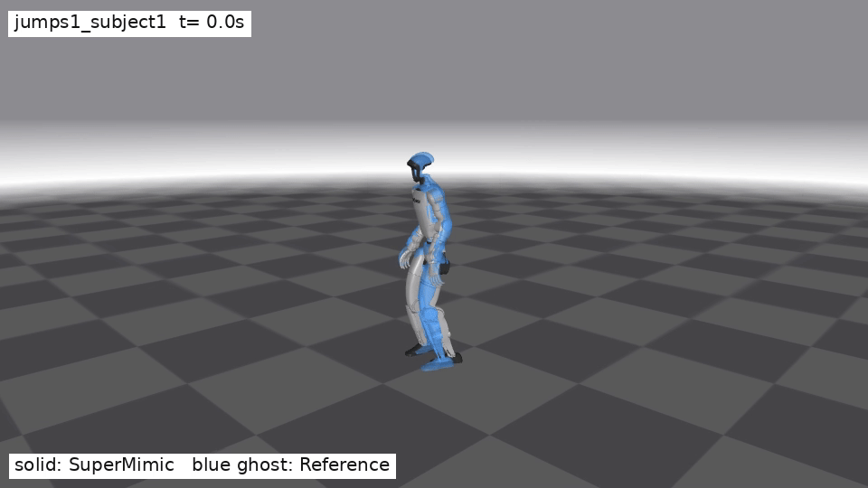
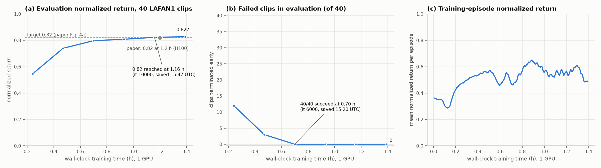

<h1 align="center">UniSuperMimic</h1>

<h3 align="center">基于 UniLab 的 SuperMimic 复现</h3>

<p align="center">语言：简体中文 | <a href="README.md">English</a></p>

<p align="center">
  <a href="https://arxiv.org/abs/2610.28480"></a>
  <a href="https://pypi.org/project/unilab/"></a>
  <a href="LICENSE"></a>
</p>

UniSuperMimic 是 [SuperMimic](https://supermimic.github.io) 在 **UniLab** 上的独立下游复现，支持 **mjwarp、MuJoCo 和 Motrix** 后端，面向 Unitree G1 的 LAFAN1 全身运动跟踪。仓库包含可微世界模型、目标条件策略、Manager-Based 任务、40 段运动资产工具，以及训练和确定性全库评估入口。

<p align="center">
  <a href="docs/assets/supermimic_comparison.mp4"></a>
</p>

<p align="center"><em>实体机器人为 SuperMimic 策略，蓝色半透明机器人为参考动作。点击图片查看 MP4。</em></p>

论文：[*SuperMimic: Scaling Humanoid Whole-Body Control with One Differentiable World Model*](https://arxiv.org/abs/2610.28480)，Qiayuan Liao 等。实现参考 `supermimic_vibed`，上游依赖为 PyPI `unilab`。

## 仓库结构

```text
unisupermimic/
├── src/unisupermimic/
│   ├── rl/
│   │   ├── algos/supermimic/       # 世界模型、策略、critic、replay 和 learner
│   │   └── contracts/supermimic.py # 环境/算法张量协议
│   ├── tasks/motion_tracking/g1/supermimic/
│   │   ├── env.py                  # Manager-Based 环境与后端工厂
│   │   ├── manager_terms.py        # command/action/observation/event/reward terms
│   │   ├── motion.py, mdp.py       # 运动库与可微 MDP
│   │   ├── evaluate.py             # 首帧确定性全 clip 评估
│   │   ├── render.py               # 策略采样与参考动作对比视频
│   │   └── registry.py             # G1SuperMimic 注册
│   ├── scripts/train_supermimic.py # 训练、续训和 eval 入口
│   ├── conf/supermimic/            # Hydra 配置
│   ├── assets/robots/g1/           # G1 MJCF；mesh/URDF 下载后不纳入 git
│   ├── assets/motions/             # LAFAN1 CSV，下载后不纳入 git
│   └── sim2sim.py                  # 策略 I/O、网络形状和资产身份校验
├── docs/assets/                    # 结果曲线、MP4 和 GIF
├── tools/prepare_supermimic_assets.py
├── tests/
├── pyproject.toml, uv.lock
├── LICENSE, LICENSES/, NOTICE
└── Makefile
```

## 安装

环境：Linux、Python 3.10–3.13、[uv](https://docs.astral.sh/uv/)；mjwarp 训练需要 CUDA GPU。以下命令均在仓库根目录执行，`uv run` 按 `uv.lock` 同步项目、PyPI `unilab`、三种仿真后端和开发依赖。

```bash
uv run unisupermimic-train --help
```

依赖变更后运行 `uv lock`。

AMD ROCm 主机改用预生成的 ROCm lockfile 安装（同样的依赖钉版，torch 为
ROCm 构建）：

```bash
make sync-rocm
```

CUDA-only 后端（mjwarp）在 ROCm 上不可用，请使用 MuJoCo host-bridge 后端
训练（`task=g1_super_mimic/mujoco`）。`make sync-rocm` 会把
`pyproject.toml`/`uv.lock` 换成 ROCm 配置档，切回默认配置档用
`make sync-default`。维护者在依赖变更后用 `make lock-rocm` 重新生成
ROCm lockfile。

### 准备资产

```bash
# 从 Hugging Face 下载 LAFAN1/G1 数据，生成并校验 MJCF
uv run tools/prepare_supermimic_assets.py

# 已有资产时，只做离线校验
uv run tools/prepare_supermimic_assets.py --validate-only
```

资产来源为 `lvhaidong/LAFAN1_Retargeting_Dataset`。完整资产应包含 40 段 CSV、264705 个源帧，每帧 36 列。mesh、URDF、CSV、日志和 checkpoint 均被 `.gitignore` 排除。

## 训练

以下命令从仓库根目录运行；使用 CUDA 时，把 `CUDA_VISIBLE_DEVICES` 改为实际空闲 GPU。

```bash
# 默认：mjwarp、4096 个并行环境、12000 iterations
CUDA_VISIBLE_DEVICES=0 uv run unisupermimic-train \
  training.log_dir=runs/supermimic_mjwarp_001

# 从同一 run 的 last.pt 续训到 16000 iterations
CUDA_VISIBLE_DEVICES=0 uv run unisupermimic-train \
  algo.resume=true \
  algo.load_run=runs/supermimic_mjwarp_001 \
  algo.checkpoint=last.pt \
  algo.iterations=16000

# 通过 task owner 选择 MuJoCo
uv run unisupermimic-train \
  task=g1_super_mimic/mujoco \
  training.log_dir=runs/supermimic_mujoco_001

# 通过 task owner 选择 Motrix
uv run unisupermimic-train \
  task=g1_super_mimic/motrix \
  training.log_dir=runs/supermimic_motrix_001
```

续训或评估 MuJoCo、Motrix run 时，使用与训练相同的 `task=g1_super_mimic/<backend>` 覆盖。Motrix 使用固定摩擦，保留质心和关节偏置域随机化。其他配置覆盖使用 Hydra 语法，例如快速 smoke 可覆盖 `algo.num_envs`、`algo.iterations`、`algo.wm_hidden`、`algo.policy_hidden` 和 `algo.compile=false`。默认完整配置见 `src/unisupermimic/conf/supermimic/config.yaml`。

## 评估

评估为每段运动创建一个环境，从首帧开始，关闭观测/动作噪声，跑完整个 clip。严格 sim2sim 校验会在环境构造前检查策略 I/O、网络形状、运动库和 MJCF 身份。

```bash
CUDA_VISIBLE_DEVICES=0 uv run unisupermimic-train \
  training.play_only=true \
  algo.load_run=runs/supermimic_mjwarp_001 \
  algo.checkpoint=12000
```

结果写入同目录的 `ckpt_012000_eval.json`。也可直接评估指定 checkpoint。独立评估和视频导出入口支持 `--backend mjwarp`、`--backend mujoco`、`--backend motrix`，默认为 mjwarp：

```bash
CUDA_VISIBLE_DEVICES=0 uv run unisupermimic-eval \
  --backend mjwarp \
  --ckpt runs/supermimic_mjwarp_001/ckpt_012000.pt
```

## 视频导出

以下命令从 checkpoint 连续采样 `jumps1_subject1`，截取第 6–14 秒的跳跃片段，生成 25 fps 的参考动作对比 MP4：

```bash
CUDA_VISIBLE_DEVICES=0 MUJOCO_GL=egl uv run unisupermimic-video \
  --backend mjwarp \
  --ckpt runs/supermimic_mjwarp_001/ckpt_012000.pt \
  --clip jumps1_subject1 \
  --start 6 \
  --seconds 8 \
  --output docs/assets/supermimic_comparison.mp4
```

默认将参考动作的 root XY 对齐策略，便于观察全身跟踪；传入 `--global-ghost` 可保留参考动作的全局位移。

## 结果

配置：PyPI `unilab 1.5.0`、mjwarp、4096 个训练环境。评估覆盖 40 段 LAFAN1/G1 运动；`norm_return` 是 clip 宏平均，`frame-weighted` 按帧数加权。

| checkpoint | norm_return | frame-weighted | 失败段数 |
|---|---:|---:|---:|
| ckpt_012000.pt | 0.827227 | 0.829952 | 0 / 40 |



## 测试

```bash
make check       # ruff、mypy、pyright
make test        # 非 slow 测试
make test-all    # 包含真实后端 slow 测试；mjwarp 需要 CUDA
uv run tools/prepare_supermimic_assets.py --validate-only
```

## License

本仓库代码采用 [Apache-2.0](LICENSE)。参考实现的 MIT 许可及原始版权声明完整保存在 [LICENSES/MIT-supermimic.txt](LICENSES/MIT-supermimic.txt)，另见 [NOTICE](NOTICE)。UniLab、UniSim、MuJoCo/mjwarp、MotrixSim 和数据集分别遵循其上游许可；本仓库不重新许可这些外部依赖或下载资产。
