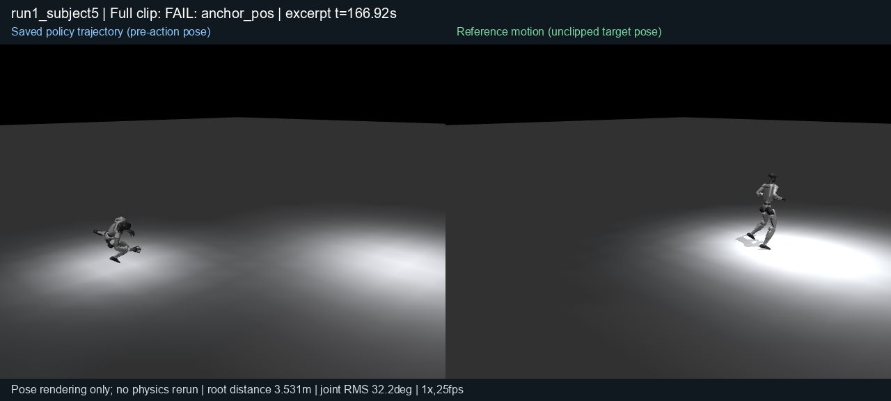

# Saved LAFAN40 trajectories, manual-reset-v2

These are pose renderings of the corrected, audited 16,001-step LAFAN40 model evaluation. They do not rerun dynamics or apply recorded actions. The complete evaluation has 39 motion-end completions and one failure, with mean normalized return 0.7971319807437383. The videos below are short excerpts; they do not replace the full evaluation and saved-array audit.

| Excerpt | Selection | Full-clip outcome |
|---|---|---|
| [Walking](28-walk1_subject1.mp4) | First 12 seconds of `walk1_subject1` | Motion end |
| [Fall and get up](08-fallAndGetUp1_subject1.mp4) | Reference minimum root height, centered in 12 seconds where possible | Motion end |
| [Failed running](23-run1_subject5.mp4) | Last 12 seconds before the terminating transition | `anchor_pos` at 166.94 seconds |

Each video is 1280×576, 300 decoded frames, 25 fps and normal playback speed. The left panel shows the saved pre-action policy pose; the right shows the same reference frame, with unclipped reference joint positions. Root/world coordinates are retained. Both panels use the same moving camera and visual G1 geometry; only floor and light are added. No physical parameter or trajectory is changed.

The footer's root distance is a global 3D position difference, and joint RMS is a direct pose diagnostic. These are not the normalized return or the native termination test. In this frozen configuration, `anchor_pos` calls `bad_anchor_pos_z_only` with a 0.25 m height threshold; horizontal displacement alone does not fail a clip. A motion-end completion therefore does not mean exact pose or global-path tracking. Some midpoint figures are small because the common camera retains the global displacement between the two poses.

[All 40 midpoint pairs](all40-midpoints.png) include every clip and the failed case. One frame per clip cannot establish temporal stability, contact quality, or full-clip tracking accuracy.

[Rendering receipt](rendering.json) binds all 40 original NPZ hashes, the evaluation result/protocol, all nine packed reference files, native XML/mesh files, joint addresses, camera and selected frame indices. The MP4 frame count and dimensions were checked by decoding every video frame. The pose-rendering source is [render_saved_lafan40.py](../render_saved_lafan40.py).
